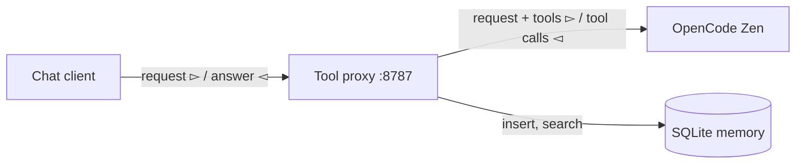

# Zen Tool Proxy

A local OpenAI-compatible endpoint that runs tools behind the model. All application code is in `app.py`.

The proxy sits between a chat client and OpenCode Zen. It adds a small memory toolset to every request. When the model calls `remember` or `recall`, the proxy runs the call and sends the result back to the model. The client sees one normal answer.



The proxy is the only process that holds the Zen key. The tools and the data stay local.

## How it works

1. The client sends `POST /v1/chat/completions` to the proxy.
2. The proxy adds a policy message and merges its tools with the client tools.
3. The proxy calls Zen.
4. If the answer has only `remember` or `recall` calls, the proxy runs them, appends the results, and calls Zen again. It repeats this loop up to 6 times.
5. If the answer has a client tool call, the proxy returns the response unchanged. The client runs its own tool.
6. The proxy returns the final answer. Streaming is buffered into valid SSE chunks.

## Requirements

- `uv`
- An OpenCode Console API key from <https://opencode.ai/console>

## Setup

1. Create the environment file:

   ```bash
   cp .env.example .env
   ```

2. Put your key in `.env`:

   ```text
   OPENCODE_API_KEY=sk-your-key-here
   ```

3. Install the dependencies:

   ```bash
   uv sync
   ```

4. Start the proxy:

   ```bash
   uv run --env-file .env python app.py
   ```

   The proxy listens on <http://127.0.0.1:8787>.

5. Check the health endpoint:

   ```bash
   curl -s http://127.0.0.1:8787/health
   ```

## Test the memory

1. Save a fact:

   ```bash
   curl -s http://127.0.0.1:8787/v1/chat/completions \
     -H 'Content-Type: application/json' \
     -d '{"model": "qwen3.8-flash", "messages": [{"role": "user", "content": "Remember that my name is Martin and I prefer tea over coffee."}]}'
   ```

2. Start a new conversation and ask for the fact:

   ```bash
   curl -s http://127.0.0.1:8787/v1/chat/completions \
     -H 'Content-Type: application/json' \
     -d '{"model": "qwen3.8-flash", "messages": [{"role": "user", "content": "What is my name and what do I prefer to drink?"}]}'
   ```

3. Read the table:

   ```bash
   uv run python -c "import sqlite3; print(*sqlite3.connect('memory.db').execute('select id, text from facts'), sep='\n')"
   ```

## Use it from a client

Point any OpenAI-compatible client at the proxy:

```python
from openai import OpenAI

client = OpenAI(base_url="http://127.0.0.1:8787/v1", api_key="local")
response = client.chat.completions.create(
    model="qwen3.8-flash",
    messages=[{"role": "user", "content": "What do you remember about me?"}],
)
print(response.choices[0].message.content)
```

The local `api_key` value is ignored. The proxy uses `OPENCODE_API_KEY` for the upstream request.

## Configuration

| Variable | Default | Meaning |
| --- | --- | --- |
| `OPENCODE_API_KEY` | none | Upstream OpenCode Zen key. Required. |
| `OPENCODE_BASE_URL` | `https://opencode.ai/inference/openai/v1` | OpenAI-compatible Zen base URL. |
| `DEFAULT_MODEL` | `qwen3.8-flash` | Model to use when the request has no `model` field. |
| `MEMORY_DB` | `memory.db` | SQLite database path. |
| `PORT` | `8787` | Listen port. |

Use a model that your key can access. The proxy exposes the key-scoped list at `/v1/models`.

## Run the tests

```bash
uv run python -m unittest discover -s tests
```

## Limitations

- The proxy waits for the full upstream answer before it sends the first SSE chunk.
- Memory is global. Every client shares one database.
- The proxy has no authentication. Keep it on `127.0.0.1`.
- Retrieval uses keyword search with SQLite `LIKE`. It does not use embeddings.
- The `usage` field describes the final upstream call, not the whole loop.

## References

Official sources:

- [OpenCode Zen models and endpoints](https://opencode.ai/docs/zen/)
- [OpenAI Chat Completions API](https://platform.openai.com/docs/api-reference/chat)
- [FastAPI](https://fastapi.tiangolo.com/)
- [uv](https://docs.astral.sh/uv/)
