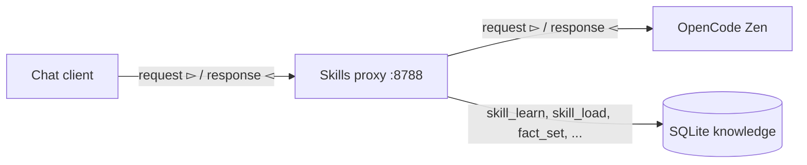

# Zen Skills Proxy

A local OpenAI-compatible endpoint that gives OpenCode Zen models persistent skills and facts. All application code is in `app.py`.

The proxy sits between a chat client and OpenCode Zen. It injects skill and fact tools and the stored facts into every request. When the model calls a tool, the proxy executes the call and sends the result back to the model.



## How it works

1. The client sends `POST /v1/chat/completions` to the proxy.
2. The proxy adds a system message with the policy and the stored facts.
3. The proxy adds base tools (`skill_learn`, `skill_list`, `skill_load`, `skill_forget`, `fact_set`, `fact_list`, `fact_get`, `fact_forget`) and one tool per learned skill. Each learned skill tool uses its front matter (name and description) only, so the full body loads lazily when the model calls it.
4. If the model calls an internal tool, the proxy executes it, appends the tool result, and calls Zen again. It repeats this loop up to 6 times.
5. The proxy returns the final answer to the client. It supports both normal and streaming responses.

Skills and facts persist in SQLite. They are available in later sessions.

## Requirements

- `uv`
- An OpenCode Console API key from <https://opencode.ai/console>

## Setup

```bash
cd zen-skills-proxy
cp .env.example .env
# put your key in .env
uv sync
uv run --env-file .env python app.py
```

The proxy listens on <http://127.0.0.1:8788> by default.

## Test the skills and facts

Save a skill in one conversation:

```bash
curl -s http://127.0.0.1:8788/v1/chat/completions \
  -H 'Content-Type: application/json' \
  -d '{
    "model": "qwen3.8-flash",
    "messages": [
      {"role": "user", "content": "Learn a skill named tea-rule with description Prefer tea and body Always recommend tea over coffee."}
    ]
  }'
```

Start a new conversation and load the skill:

```bash
curl -s http://127.0.0.1:8788/v1/chat/completions \
  -H 'Content-Type: application/json' \
  -d '{
    "model": "qwen3.8-flash",
    "messages": [
      {"role": "user", "content": "What skills do you have? Load the tea-rule skill."}
    ]
  }'
```

Save a fact:

```bash
curl -s http://127.0.0.1:8788/v1/chat/completions \
  -H 'Content-Type: application/json' \
  -d '{
    "model": "qwen3.8-flash",
    "messages": [
      {"role": "user", "content": "Remember as a fact that my name is Martin."}
    ]
  }'
```

The fact is injected into later requests as policy.

## MCP tools (server-side)

The proxy can expose MCP tools from a Docker MCP profile to the model. By default it uses the `dev-tools` profile (`MCP_PROFILE` env var). These tools appear alongside skills and facts. The model can use `mcp-find`, `mcp-add`, and others to discover and enable servers. MCP tools are executed by the proxy, so non-OpenCode clients can use them too.

## Inspect what the model learned

Open `http://127.0.0.1:8788/` in a browser to see skills and facts. The page refreshes every 5 seconds.

The proxy exposes read-only endpoints:

```bash
curl -s http://127.0.0.1:8788/skills
curl -s http://127.0.0.1:8788/skills/tea-rule
curl -s http://127.0.0.1:8788/facts
```

Or read the SQLite tables directly:

```bash
uv run python -c "import sqlite3; print('skills:', *sqlite3.connect('knowledge.db').execute('select name, description from skills'), sep='\n'); print('facts:', *sqlite3.connect('knowledge.db').execute('select key, value from facts'), sep='\n')"
```

## Run the tests

```bash
uv run python -m unittest discover -s tests
```

## Configuration

| Variable | Default | Meaning |
| --- | --- | --- |
| `OPENCODE_API_KEY` | none | Upstream OpenCode Zen key. Required. |
| `OPENCODE_BASE_URL` | `https://opencode.ai/inference/openai/v1` | OpenAI-compatible Zen base URL. |
| `DEFAULT_MODEL` | `qwen3.8-flash` | Model to use when the request has no `model` field. |
| `KNOWLEDGE_DB` | `knowledge.db` | SQLite database path. |
| `MCP_PROFILE` | `dev-tools` | Docker MCP profile exposed to the model. |
| `MAX_STEPS` | `6` | Maximum number of tool loops per request. |
| `HOST` | `127.0.0.1` | Listen address. |
| `PORT` | `8788` | Listen port. |

## Limitations

- The proxy waits for the complete upstream response before it sends the first stream chunk.
- Knowledge is global. Every client and every conversation shares the same database.
- The proxy has no authentication. It listens on `127.0.0.1` by default.
- Skills load lazily: only their front matter (name and description) is advertised as a tool; the full body loads when the model calls the skill.
- Facts are always injected into the system message as policy.
