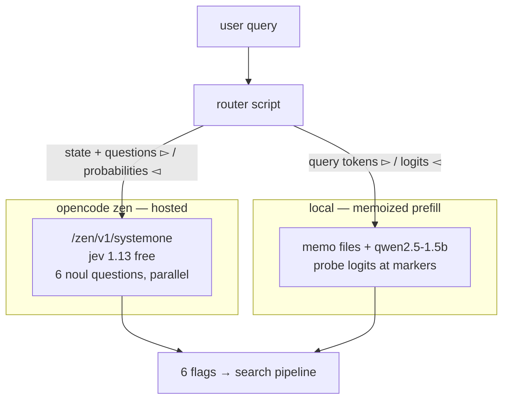

# Two Runtimes for the Search Router: Jev 1.13 Free vs the Memoized Engine

In the previous article, we built a query router for an ecommerce search engine: six yes/no questions answered per query by a small causal model reading logits at probe markers, with the routing rules prefilled once and shipped as a memo. Here we run the same bank of 22 queries through a different runtime: Jev 1.13, a hosted decision model from TypeSafe, served by OpenCode Zen as `jev-1.13-free` — free for a limited time.

Jev is a decision model, not a chat model. One request carries a `state` and typed questions; each answer comes back as a value with a probability. Its `noul` question is our probe: P(yes) for one yes/no instruction, returned directly instead of read from two logits. Questions evaluate in parallel and in isolation, so six answers cost one round trip. While the free window is open, `jev-1.13-free` answers without a key; the paid `jev-1.13` ($0.042 per million input tokens, free output) is the fallback when it closes.



## The six questions

The probe markers become noul questions and the rule text becomes `instructions` and `criteria`. `BRANDS` and `CATEGORIES` are the same lists from the previous article, and `GOLD` is its 22-query bank. No threshold fitting: the returned numbers are calibrated probabilities, so 0.5 is a usable default.

The six questions carry every rule the memo encoded in its prefix:

```python
QUESTIONS = {
    "PRICE": {"type": "noul", "instructions": "Does the query bound a price?",
              "criteria": {
                  "true": 'A price bound appears: "under 10", "cheap", "50 to 100", or an equivalent in any language',
                  "false": "No price bound appears in the query"}},
    "BRAND": {"type": "noul", "instructions": {
                  "known_brands": BRANDS,
                  "question": "Does the query mention or hint at one of the known brands?"}},
    "FUZZY": {"type": "noul", "instructions": "Does any word in the query look misspelled?",
              "criteria": {
                  "true": "A word looks misspelled or is an unknown brand spelling",
                  "false": "Every word is a correctly spelled common word or a known brand"}},
    "LOCATION": {"type": "noul", "instructions": "Does a city, country, or region name appear in the query?"},
    "CATEGORY": {"type": "noul", "instructions": {
                  "known_categories": CATEGORIES,
                  "question": 'Is the whole query a product category name or a plain category phrase, e.g. "sneakers", "running shoes", "trail boots"?'},
                 "criteria": {
                  "true": "The whole query is just a category phrase",
                  "false": "The query adds a price, a brand, a place, or a described need, recipient, or occasion"}},
    "HYBRID": {"type": "noul", "instructions": "Does the query describe a need, recipient, occasion, or use beyond naming products?",
               "criteria": {
                  "true": 'A need, recipient, occasion, or use appears: "for my wife", "birthday", "long walks", "for student"',
                  "false": "The query only names product types, brands, model numbers, colors, sizes, or prices"}},
}
```

The mechanics on top of them are the whole engine:

```python
ENDPOINT = "https://opencode.ai/zen/v1/systemone"
MODEL = "jev-1.13-free"

def decide(query):
    body = json.dumps({"model": MODEL, "state": query, "questions": QUESTIONS}).encode()
    req = urllib.request.Request(ENDPOINT, data=body, headers={
        "Content-Type": "application/json", "User-Agent": "curl/8.9.0"})
    with urllib.request.urlopen(req, timeout=60) as resp:
        answers = json.load(resp)["answers"]
    return {name: answers[name]["noul"] for name in QUESTIONS}

def main():
    total = ok = 0
    for query, gold in GOLD.items():
        t0 = time.perf_counter()
        probs = decide(query)
        ms = (time.perf_counter() - t0) * 1000
        flags = {n: int(p >= 0.5) for n, p in probs.items()}
        wrong = [n for n in flags if flags[n] != gold[n]]
        total += len(flags)
        ok += len(flags) - len(wrong)
        line = " ".join(f"{n}={'Y' if flags[n] else 'n'}({probs[n]:.2f})" for n in QUESTIONS)
        mark = "  " if not wrong else "!!"
        print(f"{mark} {query!r:45s} {line}  [{ms:.0f} ms]"
              + (f"  MISS: {','.join(wrong)}" if wrong else ""))
    a, b = decide("shoes under 10"), decide("shoes under 10")
    print(f"\naccuracy: {ok}/{total} = {ok/total:.1%}")
    print(f"determinism (rerun identical): {a == b}")
```

No torch, no GPU, no artifact to build or ship: one file, standard library only.

## Accuracy on the same bank

Both engines ran the 22-query bank at threshold 0.5 on one machine, the same day; the memoized table reproduced its published numbers exactly on a rebuild we did for this article. Most labels are no, so always-no scores 105/132 — the honest columns stay **found** and **right when yes**.

| question | memoized Qwen found | right when yes | jev found | right when yes |
|---|---|---|---|---|
| PRICE | 3 of 5 | 3 of 3 | **5 of 5** | **5 of 5** |
| BRAND | 5 of 5 | 5 of 7 | 5 of 5 | 5 of 6 |
| FUZZY | 1 of 1 | 1 of **19** | **1 of 1** | **1 of 1** |
| LOCATION | 4 of 4 | 4 of **16** | **4 of 4** | **4 of 4** |
| CATEGORY | 4 of 4 | 4 of **19** | **4 of 4** | **4 of 4** |
| HYBRID | **7 of 8** | 7 of **21** | 4 of 8 | 4 of 5 |
| all cells | 68 / 132 = 51.5% | | **126 / 132 = 95.5%** | |

The hosted model beats always-no by 21 cells; the local probe engine at a naive 0.5 lands below it. That is the yes-bias of the previous article: an abstract question answered by a 1.5B instruct model says yes often, and its two-logit ratio needs a fitted threshold to be useful. Jev's numbers arrive usable.

Jev's six misses: HYBRID says no at 0.06–0.10 on all four place queries (`running shoes from berlin`, `botas de madrid`, `靴子 北京`, `जोधपुर के जूते`) where gold expects the hybrid route; HYBRID says yes at 0.66 on `tenis para correr`, which gold labels CATEGORY only; BRAND says yes at exactly 0.50 on `running shoes from berlin` — a coin toss that landed wrong.

## Threshold fitting is the fragile part

The memoized engine ships with threshold fitting: one sweep over the labeled bank maximizes balanced accuracy. A fresh build for this article produced `PRICE 0.10, BRAND 0.10, FUZZY 0.85, LOCATION 0.90, HYBRID 0.91, CATEGORY 0.94` and scored 105/132 on the held-out bank — no better than always-no. The two low thresholds show why: on the 14-query toy label set, every candidate between the positive and negative probabilities scores the same, and the sweep's tie-break returns the first — 0.10. Any new query landing between 0.10 and the real boundary fires, like `नाइक एयर फोर्स 1` at PRICE 0.25. On toy labels, a fitted threshold is a coin toss with extra steps; real thresholds need log-mined labels.

Jev needs no fitting to reach 95.5%. Thresholds still earn their place where costs are asymmetric: opening the expensive fuzzy route on a false yes is not the same trade as missing it. And the coin toss is real: BRAND answered `running shoes from berlin` at 0.50–0.52 across runs — cells within 0.05 of the threshold deserve a dead band in code, not a reroll.

## Timing and determinism

| | memoized Qwen | jev-1.13-free |
|---|---|---|
| per-version build | 296 ms prefill + threshold sweep, 19.4 MB of files | none |
| process start | 2.0 s (model load; memo read ~50 ms) | none |
| first query | 626 ms (MPS warmup) | 1041 ms |
| steady query | 86 ms bench median (6 questions, one pass) | 846 ms median (network round trip) |
| worst query | 248 ms | 1276 ms |
| rerun identical | **bit-identical** | no; flags stable |

Ten repeated calls on one query: min 822 ms, p50 899 ms, max 1099 ms. Five repeats on one query: every probability spread at most 0.01, all flags stable; across three full-bank runs the widest drift was 0.03. The hosted model resamples its numeric answers slightly, so the script's rerun check reports False; the memoized engine reads a frozen state file and its decisions are exact, which is what lets the router key decisions by `(query, memo version)`. A hosted model can promise neither: the provider may move the weights, and free windows close. Pin the model id and re-run the labeled bank when the answer distribution shifts.

The speed gap is a factor of ten and it is honest: 86 ms of local compute against 846 ms of network plus orchestration. The hosted model wins the other axis: nothing to build, load, ship, hash, or verify.

## What the hosted decision model fixes and does not

- **The yes-bias disappears.** Right-when-yes goes from 1/19, 4/16, 4/19, 7/21 to 1/1, 4/4, 4/4, 4/5, with fitted thresholds and reworded probes as unnecessary work.
- **Multilingual PRICE is found 5/5 instead of 3/5.** The previous article's two PRICE losses were rule-text problems — the rules taught english surface forms. The equivalent edit here is "or an equivalent in any language" in the `true` criteria: one string, no memo to rebuild.
- **Knowledge ships in the request.** The 80-brand list travels as a JSON field, versioned with the code instead of as state files with a hash check.

HYBRID misses all four place queries, for the same reason the previous article's first probe wording failed: the gold label encodes what the pipeline should do — strip the place, treat it as a regional-stock or shipping modifier — but the question asks what the query says. No token in `靴子 北京` describes a need or an occasion, and a calibrated model faithfully answers no. The memoized engine caught 7 of 8 only by being wrong often. The fix is text or data, not architecture: state the shipping-modifier rule in the criteria, or relabel the bank, or drop those labels until real click logs say what `boots from madrid` should route to.

## References

Official sources:

- [OpenCode — Console models](https://opencode.ai/v2/docs/console/models/): the Jev endpoints, pricing, and free-window notes.
- [TypeSafe AI docs — Noul](https://docs.typesafe.ai/primitives/noul/): the yes/no primitive and response shape.
- [This blog — Memoized Prefill: LLM Routing with Cached Attention State](#article/llm001): the local engine and the gold bank.
