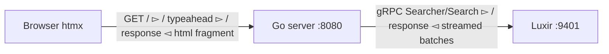

# A Hello World Search Engine with Luxir, Go, and htmx

Luxir is a new open source search engine from Yonik Seeley, the original author of Apache Solr. Version 0.1.0 is one native binary that speaks JSON over HTTP on port 9400 and typed gRPC on 9401. It needs no schema file and no cluster: a field's type comes from its name suffix, and a write to a new collection creates the collection. I put the classic Algolia ecommerce demo — typeahead, a faceted results page, a product page — on top of it, in Go and htmx.

## Start. Index. Search.

The 0.1.0 releases are Linux x86-64, so on my Apple Silicon laptop the engine runs in a container under Rosetta:

```bash
curl -fL -o luxir https://github.com/luxir-search/luxir/releases/download/v0.1.0/luxir-0.1.0-linux-x86_64-v2
docker run -d --name luxir --platform linux/amd64 -p 9400:9400 -p 9401:9401 -v "$PWD":/data ubuntu:22.04 /data/luxir
```

The [Algolia ecommerce dataset](https://github.com/algolia/datasets/tree/master/ecommerce) is 10,000 Best Buy products. The converter's whole job is renaming fields to template suffixes, and omitting the holes a zero-value language silently invents:

```go
doc := map[string]any{
    "id":      d.ObjectID,
    "title_t": d.Name,
}
if d.ShortDesc != "" {
    doc["description_t"] = d.ShortDesc
}
if d.Manufacturer != "" {
    doc["brand_name"] = d.Manufacturer
}
if len(cats) > 0 {
    doc["category_names"] = cats
}
if d.SalePrice > 0 {
    doc["price_f"] = d.SalePrice
}
```

`_t` is analyzed text, `_f` a float column, `_name` indexes one input two ways: word search *and* whole-value facets, so a query for `brand_name:bose` matches while the facet bucket still prints "Bose®", symbol and all. An NDJSON stream of those lines goes in with one curl — and note the `if` guards. The dataset has `null`s *inside* category arrays (strict ingest rejects them with per-document errors), 2,121 empty manufacturers, and null prices. Indexed as-is, they become a blank brand bucket matching thousands of products and fake $0.00 rows that "Price ↑" happily ranks first. Omit what is absent; the engine treats missing correctly. Ten thousand documents go from empty server to searchable in 1.3 seconds — emulated.

## The results page is one request

Ranked hits, facet counts, the exact total, and the average price are named operations in a single search. The whole page comes from this builder:

```go
func srpRequest(s state) *luxirpb.SearchRequest {
	query := &luxirpb.Query{Kind: &luxirpb.Query_All{All: true}}
	if s.Q != "" {
		query = &luxirpb.Query{Kind: &luxirpb.Query_SimpleQuery{SimpleQuery: &luxirpb.SimpleQuery{
			Q:      s.Q,
			Fields: []string{"title_t", "description_t", "brand_name"},
		}}}
	}
	buckets := []*luxirpb.QueryBucket{}
	for _, b := range priceBuckets {
		r := &luxirpb.RangeQuery{Field: "price_f"}
		if b.Min != nil {
			r.Gte = valNum(*b.Min)
		}
		if b.Max != nil {
			r.Lt = valNum(*b.Max)
		}
		buckets = append(buckets, &luxirpb.QueryBucket{
			Name:  b.Label,
			Query: &luxirpb.Query{Kind: &luxirpb.Query_Range{Range: r}},
		})
	}
	limit6 := int64(6)
	td := &luxirpb.TopDocs{
		Query:          query,
		Limit:          func() *int64 { v := int64(pageSize); return &v }(),
		GetNumber:      true,
		Fields:         []string{"id", "title_t", "brand_name", "price_f", "image_s"},
		DocumentFormat: luxirpb.DocFormat_ROWS,
	}
	if s.Sort != "" {
		td.Sort = []*luxirpb.SortSpec{sortSpecs[s.Sort]}
	}
	if s.Page > 1 {
		td.Offset = int64((s.Page - 1) * pageSize)
	}
	td.Ops = map[string]*luxirpb.SearchOp{
		"categories": {Kind: &luxirpb.SearchOp_FieldFacet{FieldFacet: &luxirpb.FieldFacet{
			Field: "category_names", Limit: &limit6, Selected: selectedVal(s.Categories), Missing: true,
		}}},
		"brands": {Kind: &luxirpb.SearchOp_FieldFacet{FieldFacet: &luxirpb.FieldFacet{
			Field: "brand_name", Limit: &limit6, Selected: selectedVal(s.Brands), Missing: true,
		}}},
		"prices": {Kind: &luxirpb.SearchOp_QueryFacet{QueryFacet: &luxirpb.QueryFacet{
			Buckets: buckets, Selected: selectedVal(s.Prices),
		}}},
		"avg_price": {Kind: &luxirpb.SearchOp_ExprOp{ExprOp: &luxirpb.ExprOp{Expr: "avg(price_f)"}}},
	}
	return &luxirpb.SearchRequest{
		Collection: "products",
		Ops:        map[string]*luxirpb.SearchOp{"q": {Kind: &luxirpb.SearchOp_TopDocs{TopDocs: td}}},
	}
}
```

The `Selected` array on each facet is the whole guided-navigation UX, and there is no filter logic anywhere else in the server. Luxir applies every facet's selections to the results, and excludes a facet's *own* selection when counting its buckets. With Sony and "$100 to $300" checked, the response says `found: 9` — and the brands list still offers "Beats by Dr. Dre (40)", because the user may want to add a second brand. That's the one behavior that makes a faceted sidebar honest, and here it's a field in the request.

The same request as JSON, which is how I explored before writing any Go (the HTTP endpoint accepts exactly this):

```json
{ "query": {"simple_query": {"q": "headphones", "fields": ["title_t","description_t"]}},
  "limit": 12, "get_number": true,
  "ops": {
    "brands": {"field_facet": {"field": "brand_name", "selected": ["Sony"]}},
    "prices": {"query_facet": {"buckets": {"$100 to $300": {"range": {"field": "price_f","gte":100,"lt":300}}},
                 "selected": ["$100 to $300"]}},
    "avg_price": "avg(price_f)" } }
```

```json
{"found": 9,
 "docs": [{"id":"4550834","title_t":"Sony - 200W 2.0-Ch. Stereo Receiver","price_f":149.99}, ...],
 "ops": {
   "avg_price": 160.54556020100912,
   "prices": {"buckets": [{"val":"$100 to $300","count":9}, ...]},
   "brands": {"buckets": [{"val":"Beats by Dr. Dre","count":40},{"val":"Bose®","count":19},
                          {"val":"Sony","count":9}, ...]}}}
```

`get_number` is opt-in, and the docs explain why: without it the engine prunes with score bounds instead of counting; ask, and the number is exact, never estimated.

## Typeahead is one request too

Product prefixes, plus brand and category *suggestions* — which means deduplicated values with counts. Two facet ops whose `domain` restricts them to prefix matches:

```go
func prefixQuery(field, prefix string) *luxirpb.Query {
	return &luxirpb.Query{Kind: &luxirpb.Query_Prefix{Prefix: &luxirpb.PrefixQuery{Field: field, Prefix: prefix}}}
}

func taRequest(q string) *luxirpb.SearchRequest {
	limit5 := int64(5)
	limit3 := int64(3)
	return &luxirpb.SearchRequest{
		Collection: "products",
		Ops: map[string]*luxirpb.SearchOp{
			"products": {Kind: &luxirpb.SearchOp_TopDocs{TopDocs: &luxirpb.TopDocs{
				Query:          prefixQuery("title_t", q),
				Limit:          &limit5,
				Fields:         []string{"id", "title_t", "brand_name", "price_f", "image_s"},
				DocumentFormat: luxirpb.DocFormat_ROWS,
			}}},
			"brands": {
				Kind:   &luxirpb.SearchOp_FieldFacet{FieldFacet: &luxirpb.FieldFacet{Field: "brand_name", Limit: &limit3}},
				Domain: &luxirpb.Domain{Query: prefixQuery("brand_name", q)},
			},
			"categories": {
				Kind:   &luxirpb.SearchOp_FieldFacet{FieldFacet: &luxirpb.FieldFacet{Field: "category_names", Limit: &limit3}},
				Domain: &luxirpb.Domain{Query: prefixQuery("category_names", q)},
			},
		},
	}
}
```

Typing `sam` returns all three lists in one round trip: products, and `{"val":"Samsung","count":356},{"val":"Samson","count":12},{"val":"Samsonite","count":5}`. The deduplication that an Algolia-style suggester does with extra indexes and client code is a facet over a restricted domain.

## Decoding the response

Over gRPC, facet buckets arrive columnar: bucket values in a dense string column, counts in a parallel array. The decode is smaller than the JSON equivalent would be:

```go
func facetBuckets(resp *luxirpb.SearchResponse, qops map[string]*luxirpb.Val, name string) []bucket {
	var fr *luxirpb.FacetResult
	if qops != nil {
		fr = qops[name].GetFacet()
	} else {
		fr = resp.GetOps()[name].GetFacet()
	}
	if fr == nil {
		return nil
	}
	ids := fr.GetBucketIds().GetColS().GetV()
	var out []bucket
	for i, id := range ids {
		b := bucket{Val: id}
		if i < len(fr.GetCounts()) {
			b.Count = int(fr.GetCounts()[i])
		}
		out = append(out, b)
	}
	return out
}
```

The product page is the same machinery: `any_of` on `id` reads the document, a boolean query finds related products that share a category *and are not the page's own product*, and a brand fallback saves the row when a product's only category has exactly one product in it (a certain Beats cable taught me that one):

```go
&luxirpb.Query{Kind: &luxirpb.Query_Boolean{Boolean: &luxirpb.BooleanQuery{
    Required:   []*luxirpb.Query{anyOfQuery("category_names", p.Categories)},
    Prohibited: []*luxirpb.Query{anyOfQuery("id", []string{p.ID})},
}}}
```

No get-by-ID endpoint exists in 0.1.0, and none is needed: the ID is an ordinary indexed field.

## Go and htmx



The browser never talks to Luxir directly: the engine ships no CORS, and the templates should not build search bodies. One Go server with three routes, and one trick on `/` — the same URL is a full page, a swap fragment, and a history restore, told apart by headers:

```go
	w.Header().Set("Content-Type", "text/html; charset=utf-8")
	name := "page"
	// Live htmx swaps get the fragment. A history restore (HX-History-Restore-Request)
	// replaces the whole document and must receive the full page.
	if r.Header.Get("HX-Request") != "" && r.Header.Get("HX-History-Restore-Request") != "true" {
		name = "srp"
	}
	if err := tmpl.ExecuteTemplate(w, name, v); err != nil {
		log.Println(err)
	}
```

Every facet, chip, sort, and pagination link is a plain `<a>` whose `hx-get` matches its `href`, so the page also works with htmx failing to load. The swap contract lives once on the container, which htmx inherits to every link inside it:

```html
<div id="results" hx-history-elt hx-history="false"
     hx-target="#results" hx-swap="innerHTML" hx-push-url="true">
```

And the search box: a form that swaps the fragment, plus an input that fetches suggestions on a debounced keyup, with two event filters that carry real weight:

```html
<form hx-get="/" hx-target="#results" hx-swap="innerHTML" hx-push-url="true"
      hx-on::after-request="if (event.detail.pathInfo.requestPath === '/') {
        document.getElementById('q').dispatchEvent(new CustomEvent('htmx:abort'));
        document.querySelector('.ta').innerHTML='' }">
  <input type="search" id="q" name="q"
         hx-get="/typeahead" hx-target=".ta" hx-swap="innerHTML"
         hx-trigger="keyup[event.key != 'Enter' && event.key != 'Escape'] changed delay:150ms"
         hx-on::blur="this.dispatchEvent(new CustomEvent('htmx:abort'));
           setTimeout(() => document.querySelector('.ta').innerHTML='', 250)">
</form>
```

The meta line reports what the engine took, measured in the handler around the gRPC call:

```
330 products · 8.4 ms round trip for “headphones” · average price $88.51
```

## What it looks like

Typing `sam`: five products with thumbnails and prices, then brand and category suggestions with counts, one round trip.


The results page: exact matches, facet sidebar with alternatives still counted, the selection as a chip, all from one request:


The product page carries a breadcrumb (Search › category › brand › product) and a related row from the boolean query above.

## Four htmx lessons, all learned in a browser

**`hx-boost` on a container clobbers the page.** Boosted links on a section swap into `document.body`, and my dark header vanished on the first facet click. Explicit `hx-get` links plus an inherited `hx-target` on a stable container fixed it.

**Events bubble into `hx-on`.** The form's dropdown-clear handler also ran on the *typeahead* response and erased it. The fix guards on `detail.pathInfo.requestPath` — `requestInfo.action` is not on the `afterRequest` detail, and a typo'd guard throws silently.

**`type="search"` clears itself on Escape**, after htmx handlers run, and the resulting "changed" keyup re-opens the dropdown. Escape gets a plain DOM listener, and closing on blur waits 250 ms — clearing on blur instantly deletes a suggestion between `mousedown` and `mouseup`, so clicks do nothing.

**Browsers cache your fragments and replay them as pages.** With no `Cache-Control`, back-navigation after a product-page visit served the *cached swap fragment* as the document — headerless, network idle. Search is never cacheable; middleware is three lines and saves a day:

```go
func noStore(h http.HandlerFunc) http.HandlerFunc {
	return func(w http.ResponseWriter, r *http.Request) {
		w.Header().Set("Cache-Control", "no-store")
		h(w, r)
	}
}
```

## Numbers and caveats

Search round trip: 4–10 ms including Docker port forwarding through Rosetta, exact counts included; the JSON HTTP endpoint measured around 10 ms for the same request, so at this scale gRPC buys typed messages, not throughput. Single node, no auth, TLS, CORS, or macOS build — pre-1.0, and the docs say so plainly. The whole front end is about 400 lines of Go and four templates, of which most is CSS. The API story is the point: plain JSON to explore, one request per screen, schema from field names.

## Run it yourself

```bash
go run ./cmd/convert bestbuy_seo.json > products.ndjson
curl -X POST 'http://localhost:9400/collections/products/_update?commit=true' \
  -H 'Content-Type: application/x-ndjson' --data-binary @products.ndjson
go run .   # http://localhost:8080
```

With the generated `luxirpb` client, a `buf generate` step against the two protos shipped in the release produces the typed messages above. Next up: product embeddings into an `embedding_v` vector field, where a `knn` query is a query like any other and rank fusion blends lexical and vector hits in one request.

## References

- [Luxir quickstart](https://luxir.org/docs/latest/guide/quickstart/) — start, index, search, NDJSON ingest, field-suffix templates
- [Faceting and metrics](https://luxir.org/docs/latest/guide/faceting/) — `selected` multi-select and per-operation counting rules
- [Searching](https://luxir.org/docs/latest/guide/searching/) and [gRPC API](https://luxir.org/docs/latest/guide/grpc/) — `get_number`, `domain`, streamed columnar results
- [HTTP API conventions](https://luxir.org/docs/latest/guide/http-api/) — the documented security boundary: no TLS, no auth, no CORS
- [algolia/datasets](https://github.com/algolia/datasets/tree/master/ecommerce) — the Best Buy dataset; [Algolia's tutorial](https://www.algolia.com/doc/onboarding/) — the demo pattern this reproduces (third-party docs, context only)
- [htmx history and events](https://htmx.org/docs/#history) — `hx-push-url`, `HX-History-Restore-Request`, `hx-history-elt`, `htmx:afterRequest` detail fields
