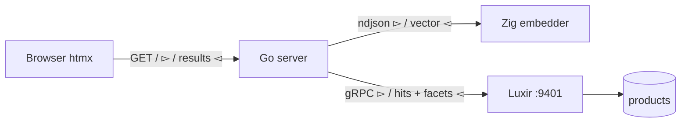

# Hybrid Search in Luxir with RRF and a Zig Embedder

The [last post](https://mschonaker.github.io/#article/luxir001) put ten thousand Algolia products in Luxir and built a search page where every screen was one request. It ended with a sentence about what came next: product embeddings in an `embedding_v` field, a `knn` query as a query like any other, and rank fusion blending lexical and vector hits in one request. This is that. Same dataset, same Go server, same htmx page — and the same Zig embedder from [Computing Embeddings in Pure Zig](https://mschonaker.github.io/#article/zig-onnx-embeddings), which turned out to need more work than the engine did.

The short version: yes, it uses RRF, the fusion operation is one field in one request, and adding vectors to the index costs 1.55 seconds on top of 1.40. The longer version is four traps, a tokenizer bug in my own earlier code, and a recall curve worth looking at.

## Four things to decide before you start

**The metric has to exist before the first document goes in.** `_v` stores a vector, but a searchable vector field needs a similarity metric, and Luxir says so plainly:

```
{"error":{"kind":"invalid_request","code":"invalid_request",
  "message":"KnnQuery on vector field without metric: embedding_v"}}
```

So the schemaless "a write creates the collection" trick does not cover vectors. One call goes first, and it creates the collection on the way:

```bash
curl -X POST http://localhost:9400/collections/products/_schema \
  -H 'Content-Type: application/json' \
  -d '{"fields":{"embedding_v":{"type":"vector","dims":384,"metric":"cosine"}}}'
```

I got this wrong first and indexed ten thousand documents with no metric, then set the schema afterwards. The search stopped erroring and started lying: cosine fields normalize on write, and vectors written before the metric was known were never normalized, so scores came back above 1.0 — a 2.03 "cosine". The engine did not warn me. Declaring the field first costs one curl.

**The embedding is the expensive half.** Not in the engine: in the model. One MiniLM forward pass is about a millisecond, but the 54 MB model and the 30 000-entry WordPiece vocabulary cost 43 ms to load, and a process spawn costs more again. Spawning a fresh embedder per query meant 165 ms before the engine was even asked a question. Keep one warm and it is 1.3 ms. I will come back to this.

**`selected` does not work under a fusion.** Guided navigation in the first post lived entirely in the `selected` array of each facet. Luxir rejects that one level down:

```
facet 'brands' at Fusion.ops: selected is only supported on
facets directly inside TopDocs.ops
```

Under a fusion you build the selection filters yourself and put them on the fusion's `filter`, which the engine computes once per segment and applies inside every source. The facet counts still come back; only the selection bookkeeping has to move.

**kNN latency is O(corpus × dims), not O(k).** Exact search scans the whole column every time. Asking for `k: 20` and asking for `k: 500` cost the same, because k only limits how many hits are kept. At ten thousand products by 384 dimensions that is a 15 MB scan and about 14 ms under emulation. This is the one number that decides your architecture.

## The embedder, again, but as a service

The first post's embedder computed one embedding per run. Reusing it for ten thousand documents meant four changes.

**The ONNX session has to outlive the call.** The old wrapper created the environment and session, ran, and released everything — per invocation. The new one holds it:

```c
struct Embedder {
    const OrtApi *api;
    OrtSessionOptions *options;
    OrtSession *session;
    OrtMemoryInfo *mem_info;
    OrtValue *inputs[3];
    OrtValue *output;
    OrtTensorTypeAndShapeInfo *shape_info;
    int64_t *shape;
    int64_t *ids, *mask, *types;
    int seq_cap;
    int dim;
};

Embedder *embedder_new(const char *model_path, int intra_threads);
float *embedder_embed(Embedder *e, const int64_t *input_ids,
                      const int64_t *attention_mask,
                      const int64_t *token_type_ids, int seq_len);
void embedder_free(Embedder *e);
```

Three details cost me a crash each. The output tensor must **not** be pre-allocated — `last_hidden_state` has a dynamic shape, so pre-allocating it pins the run to the first sequence length and every longer document fails with `computed output shape for this run is {1,15,384}`. The input buffers have to be **owned by the wrapper**, because the runtime holds a pointer to them for as long as the tensor lives and a Zig `ArrayList` will happily move its memory underneath it. And `shape[1]` has to be set before the tensors are created, or the first probe runs with sequence length zero and returns a null data pointer.

**The protocol is NDJSON in, NDJSON out, one line at a time.** The same loop serves both jobs — a file piped in is a batch, a held-open pipe is a service:

```zig
// One line in, one line out, answered before the next line is read. A caller
// that writes one line and reads one line gets a service; a caller that
// pipes a file gets a batch job. Same loop either way.
while (try in.takeDelimiter('\n')) |line| {
    if (line.len == 0) continue;
    // ... tokenize, embed ...
    try out.writeAll(line[0 .. line.len - 1]);
    try out.print(",\"{s}\":[", .{o.out});
    for (embedding, 0..) |v, d| {
        if (d > 0) try out.writeByte(',');
        try out.print("{d:.5}", .{v});
    }
    try out.writeAll("]}\n");
    try out.flush();
}
```

Splicing the vector onto the original line instead of re-encoding the document avoids a parse-and-reserialize per row. Flushing per line is what makes the request/response case work; the cost is invisible next to 6 ms of inference.

**The tokenizer was wrong, and only one test had ever checked it.** The first post validated `hello world` against Python's transformers and got an exact match, which felt like validation. It was validation of one sentence, and one sentence where every word is a whole vocabulary entry.

WordPiece splits a word into a leading piece plus `##` continuations. `headphone` is `head` + `##phone` (ids 2132, 9864). The old greedy scan never prefixed `##`, so it produced `head` + `phone` (2132, 3042) — the standalone word — and threw the rest of the word away. Every non-dictionary word in the corpus was being truncated to its longest known prefix.

```zig
/// WordPiece: at each position take the longest vocabulary entry that starts
/// there, then carry on from where it ended. The first piece of a word is
/// looked up plain, every later piece with the "##" prefix — `headphone` is
/// `head` + `##phone`, not `head` + `phone`.
fn wordPieces(
    allocator: std.mem.Allocator,
    t: *Tokenizer,
    word: []const u8,
    max_tokens: usize,
    out: *std.ArrayList(i64),
) !void {
    var buf: [max_word_chars + 2]u8 = undefined;
    var start: usize = 0;
    var first = true;

    while (start < word.len and out.items.len < max_tokens) {
        const limit = if (first) word.len else @min(word.len, start + max_word_chars);
        const prefix_len: usize = if (first) 0 else 2;
        if (prefix_len == 2) {
            buf[0] = '#';
            buf[1] = '#';
        }

        var end = limit;
        while (end > start) : (end -= 1) {
            @memcpy(buf[prefix_len..][0 .. end - start], word[start..end]);
            const piece = buf[0 .. prefix_len + end - start];
            if (t.vocab.get(piece)) |id| {
                try out.append(allocator, id);
                start = end;
                first = false;
                break;
            }
        } else {
            if (first) try out.append(allocator, t.unk_token_id);
            start += 1;
        }
    }
}
```

Two more things were missing. The model's normalizer folds accents, so `café` must reach the same piece as `cafe` and `nüvi` as `nuvi` — a small table of Latin-1 and Latin Extended-A ranges does it. And BERT's pre-tokenizer makes punctuation its own word, but this vocabulary *contains* `-`, `"` and `'`, so they are tokens rather than things to delete.

Seven unit tests now pin this to reference ids, and they are the part of it I would keep if I deleted everything else:

```zig
test "continuation pieces carry ##" {
    var t = try fixture();
    defer free(test_allocator, &t);
    try expectIds(&t, "headphone", &.{ 101, 2132, 9864, 102 });
    try expectIds(&t, "headphones", &.{ 101, 2132, 19093, 102 });
    try expectIds(&t, "webroot", &.{ 101, 4773, 3217, 4140, 102 });
}

test "accents are stripped" {
    var t = try fixture();
    defer free(test_allocator, &t);
    try expectIds(&t, "caf\u{00E9}", &.{ 101, 7668, 102 });
}

test "symbols stay inside the word" {
    var t = try fixture();
    defer free(test_allocator, &t);
    try expectIds(&t, "Bose\u{00AE} QuietComfort\u{00AE} 15", &.{
        101, 21299, 29656, 4251, 9006, 13028, 29656, 2321, 102,
    });
}
```

Over the whole corpus, 9,993 of 10,000 documents now tokenize identically to `huggingface/tokenizers`. The seven that do not are one Spanish CD title with an inverted exclamation mark and six documents longer than the reference's 128-token model limit, where this implementation keeps going to 256.

And the original test still holds. The token ids are the ones the earlier post printed, and the embedding matches it to four decimal places — the earlier run and this one differ only in the fourth decimal of the fourth dimension, which is what a Q4-quantized model buys:

```
Token ids: 101 7592 2088 102
Embedding (first 10 dims): -0.1761, 0.2930, 0.1513, -0.0302, -0.1342,
                           -0.7992, 0.2508, 0.0200, -0.3306, 0.0226
Embedding dimension: 384   norm: 5.9607
```

**The Go side keeps one child alive.** Shelling out per request cost 165 ms; a long-lived process with a mutex costs 1.3 ms:

```go
// embedder is a long-lived child process. The Zig binary loads the 54 MB model
// and the 30 000-entry WordPiece vocabulary once, then answers one NDJSON line
// per line. Spawning it per query cost 120 ms of startup to do 0.9 ms of work;
// here the query vector costs about a millisecond.
type embedder struct {
	bin, dir, threads, maxTokens string

	mu     sync.Mutex
	cmd    *exec.Cmd
	stdin  io.WriteCloser
	stdout *bufio.Reader
	stderr *bytes.Buffer
}

func (e *embedder) embed(text string) ([]float32, error) {
	if strings.TrimSpace(text) == "" {
		return nil, nil
	}
	e.mu.Lock()
	defer e.mu.Unlock()

	if e.cmd == nil {
		if err := e.startLocked(); err != nil {
			return nil, err
		}
	}
	vec, err := e.roundTrip(text)
	if err == nil {
		return vec, nil
	}

	// The child died or closed its pipes. Replace it and retry once, so a
	// crashed embedder costs one request instead of the process.
	e.killLocked()
	if restartErr := e.startLocked(); restartErr != nil {
		return nil, err
	}
	return e.roundTrip(text)
}
```

Spawning once per *document* is fine — that is 64 seconds of model loading amortized over ten thousand rows. Spawning once per *query* is not. That asymmetry is the whole design: bulk work wants a batch job, interactive work wants a service, and the same line protocol gives you both.

## What indexing costs

Three runs each way, into a fresh collection every time, under Rosetta:

| Index | NDJSON | Wall clock |
|---|---|---|
| text fields only | 3.56 MB | 1.38 s, 1.40 s, 1.42 s |
| with `embedding_v` | 36.35 MB | 2.96 s, 2.96 s, 2.97 s |

So 384 float32 per product costs about **1.55 seconds**, or 2.1× the text-only index, for a payload 10.2× larger. The vector column is the dominant part of the bytes but not of the time: the extra second and a half covers parsing and storing 3.84 million floats along with 10× the text, and no approximate index has been built yet.

That is the honest comparison. The embedding step is separate and much larger:

```
9,999 docs, 378,697 tokens, 64.63 s, 155 docs/s, 6.46 ms/doc
startup: model 41 ms, tokenizer 5 ms, 384 dims
```

64.6 seconds of compute to make the index 1.55 seconds more expensive. **Compute your vectors once, offline, and store them.** A six-thread MiniLM-L6-v2 on an M-series laptop runs at 155 documents a second on full product text; nobody should pay that on a request path.

Two details worth knowing. Nine thousand nine hundred and ninety-nine of ten thousand products got a vector — one document has an empty title and no description, and the embedder passes it through untouched rather than writing a zero vector, because a zero vector has no direction and cosine skips it anyway. And the token count went from 24 per document to 37.9 once the tokenizer stopped truncating words; the 1.7× slower embed rate is the price of that bug being gone.

## How hybrid search works

Two round trips happen before the browser sees anything: one to the embedder for the query vector, one to Luxir for the ranking. The embedder is a child process, so it is not a network hop — but it is a request/response, and it is the first one:



A `knn` query is a query. It goes wherever a query goes:

```json
{ "query": { "knn": { "field": "embedding_v", "query": [0.75, 0.15, 0.10], "k": 20 } },
  "limit": 10, "get_scores": true }
```

Filters are applied *inside* the vector search, so `k: 20` means twenty filtered neighbours, not twenty minus whatever a later filter discarded. That is what makes faceted hybrid search honest rather than approximate.

Blending it with BM25 is a `fusion` operation, and `rrf` is the only method in 0.1.0. The whole request, over HTTP JSON, is:

```json
{ "ops": { "hybrid": { "fusion": {
  "sources": {
    "lexical":  { "query": { "simple_query": { "q": "noise cancelling earbuds",
                                              "fields": ["title_t","description_t","brand_name"] } },
                   "limit": 200 },
    "semantic": { "query": { "knn": { "field": "embedding_v", "query": [0.12, ...], "k": 200 } },
                   "limit": 200 }
  },
  "rrf": { "k": 60 },
  "limit": 12, "get_scores": true,
  "fields": ["id", "title_t", "brand_name", "price_f"],
  "ops": { "brands": { "field_facet": { "field": "brand_name", "limit": 6 } } }
} } } }
```

In Go it is the same shape, and the parts worth reading are the shared filter and the two independent limits:

```go
sources := map[string]*luxirpb.TopDocs{
	"words": {
		Query:          lexicalQuery(s.Q),
		Limit:          &pool,   // candidate window, not page size
		Fields:         resultFields,
		DocumentFormat: luxirpb.DocFormat_ROWS,
	},
	"vectors": {
		Query:          knnQuery(qvec, s.Pool),
		Limit:          &pool,
		Fields:         resultFields,
		DocumentFormat: luxirpb.DocFormat_ROWS,
	},
}
return &luxirpb.SearchRequest{
	Collection: collection,
	Ops: map[string]*luxirpb.SearchOp{"q": {Kind: &luxirpb.SearchOp_Fusion{Fusion: &luxirpb.Fusion{
		Sources:         sources,
		Filter:          selectionFilters(s),  // computed once, applied inside both
		Method:          &luxirpb.Fusion_Rrf{Rrf: &luxirpb.RrfFusion{K: 60}},
		Limit:           &limit,
		Offset:          int64((s.Page - 1) * pageSize),
		GetNumber:       true,
		GetScores:       true,
		Fields:          resultFields,
		DocumentFormat:  luxirpb.DocFormat_ROWS,
		Ops:             facetOps(s, false),  // no `selected` under a fusion
	}}}},
}
```

The score is the whole trick: each document's rank in each source contributes `1 / (60 + rank)`, ranks starting at one, and the contributions are summed. A document that both sources like beats a document that one source loves. Nothing has to convert a BM25 score into a cosine or the reverse, which is the part that usually goes wrong.

Here is the engine's actual output for `noise cancelling earbuds`, with the arithmetic next to it:

| Product | words | vectors | 1/(60+rank) | sum | engine |
|---|---|---|---|---|---|
| Bose® QuietComfort® 15 | 1 | 2 | 0.016393 + 0.016129 | 0.032522 | 0.032522 |
| Bose® QuietComfort® 20 | 3 | 1 | 0.015873 + 0.016393 | 0.032266 | 0.032266 |
| Bose® QuietComfort® 20i | 4 | 3 | 0.015625 + 0.015873 | 0.031498 | 0.031498 |
| Sony Earbud Headphones | 6 | 4 | 0.015152 + 0.015625 | 0.030777 | 0.030777 |

Six decimal places, exactly. The Bose 15 ranked first lexically and second by vector; the Bose 20 did the reverse; RRF barely separated them and put both on top, which is the intended behaviour.

### The candidate pool is the recall knob

Each source's `limit` bounds its candidate window, and a document outside that window cannot contribute from that source. The page size is not the pool size. For `cheap television for a small bedroom`:

| Pool | found | top hit |
|---|---|---|
| 20 | 40 | Samsung 3D Active Glasses |
| 50 | 97 | Antennas Direct ClearStream Digital TV Antenna |
| 200 | 387 | Antennas Direct ClearStream Digital TV Antenna |
| 500 | 952 | Antennas Direct ClearStream Digital TV Antenna |

At 20 the fusion is starved — 40 documents across two sources, and the top hit is 3D glasses. At 200 it settles. The row of buttons in the app is this table, live.

Two things about `found` on a fusion: it counts the **union of the source windows**, not the corpus, so it is only an honest total while the pool is wide; and fusion `offset` pages within that union without enlarging it, so deep pages need bigger source limits.

## What it looks like

Hybrid is the default. `cos` is the raw cosine score and `rrf` the fused one, and switching modes switches which number you see:


Vectors alone, with the pool turned down to 20. A literal word like "headphones" pulls toward in-ear products, because that is genuinely what the query vector is closest to — and it is the clearest argument for not shipping vector search without a lexical source:


## Latency

Engine round trip over gRPC, including the four facet operations and the exact count, median of nine:

| Query | words | vectors | + embed | hybrid | + embed |
|---|---|---|---|---|---|
| headphones | 3.5 ms | 4.5 ms | 0.9 ms | 5.0 ms | 1.0 ms |
| noise cancelling earbuds | 2.3 ms | 4.6 ms | 1.1 ms | 5.0 ms | 1.1 ms |
| wireless earbuds with long battery life | 4.6 ms | 4.5 ms | 1.3 ms | 6.7 ms | 1.3 ms |
| cheap television for a small bedroom | 4.2 ms | 4.5 ms | 1.3 ms | 6.5 ms | 1.3 ms |
| headfones | 1.0 ms | 4.5 ms | 1.3 ms | 4.7 ms | 1.3 ms |
| gift for a ten year old | 4.3 ms | 4.4 ms | 1.3 ms | 6.3 ms | 1.3 ms |
| **median** | **3.9 ms** | **4.5 ms** | **1.3 ms** | **5.7 ms** | **1.3 ms** |

Hybrid costs about 1.5× a lexical search and 1.3× a vector search, and the query embedding is now a fifth of the total. Every one of these numbers includes the Rosetta emulation and the Docker port forwarding; natively the gaps would be the same shape and the absolute values smaller.

One number is worth isolating: `headfones`, a typo, takes **1.0 ms lexically and finds nothing**. The same typo in vector mode takes 4.5 ms and returns Skullcandy Uprock headphones, Skullcandy Hesh 2.0, and Hello Kitty jeweled earbuds. RRF does not rescue it — with an empty lexical source, hybrid degrades to the vector list with different scores. Fusion boosts agreement; it cannot manufacture results. That is worth knowing before you assume hybrid fixes typos.

## Exact, approximate, and what recall costs

Nothing above used an approximate index. `{"commit":{"build_aux_indexes":["vec.embedding_v"]}}` builds an IVF+PQ overlay through FAISS at commit time, and at ten thousand vectors Luxir decides it is worth building. The query does not change:

| Query | exact | approximate | speedup | recall@10 | recall@100 |
|---|---|---|---|---|---|
| headphones | 15.6 ms | 3.7 ms | 4.2× | 100% | 100% |
| wireless earbuds with long battery life | 14.0 ms | 3.8 ms | 3.7× | 90% | 99% |
| cheap television for a small bedroom | 14.0 ms | 3.5 ms | 4.0× | 90% | 96% |
| something to keep my ears warm in winter | 14.2 ms | 3.9 ms | 3.6× | 100% | 99% |
| gift for a ten year old | 14.6 ms | 3.6 ms | 4.0× | 80% | 73% |
| kitchen stand mixer | 14.0 ms | 3.7 ms | 3.8× | 100% | 100% |

`exact: true` is the built-in ground truth — same filters, same multi-value collapse, same score scale, full-precision scan. Run a query both ways and diff. `ivf.nprobe` is the dial between them, and for `headphones` it moves nothing: 2.9 ms at `nprobe: 1` and 4.5 ms at `nprobe: 64`, both at 100% recall, because the query lands in a cluster whose neighbours are already the answer.

Here is the honest read of that table: **a 4× speedup bought 0–20% recall loss, on a search that was already fast enough.** At ten thousand documents I would ship `exact: true` and keep the overlay for when the corpus is two orders of magnitude larger. The overlay exists and it works and I still would not turn it on here. Measure your own recall before you trust a default.

The engine side was the easy half. `knn` is a query, `fusion` is an operation, and RRF is twenty lines of arithmetic that Luxir gets exactly right. The half that cost the afternoon was on my side of the pipe.

## References

- [Luxir vector and hybrid search](https://luxir.org/docs/latest/guide/vector-search/) — `knn`, `fusion`, `rrf`, `build_aux_indexes`, `exact`, `ivf.nprobe`, and the candidate-pool rule
- [Luxir vector search design](https://luxir.org/docs/latest/design/vector-search/) — how the overlay and rescoring work internally
- [Luxir faceting](https://luxir.org/docs/latest/guide/faceting/) — `selected` multi-select, and why it is `TopDocs`-only
- [Luxir schema and fields](https://luxir.org/docs/latest/guide/schema/) — the vector template and metric declaration
- [HuggingFace tokenizers](https://huggingface.co/docs/tokenizers) — the reference implementation the seven tests are pinned to
- [BERT WordPiece tokenization](https://arxiv.org/abs/1810.04805) — why continuation pieces carry `##`
- [Reciprocal Rank Fusion](https://arxiv.org/abs/1409.7616) — Cormack, Clarke and Buettcher, the paper RRF comes from
- [sentence-transformers/all-MiniLM-L6-v2](https://huggingface.co/sentence-transformers/all-MiniLM-L6-v2) — the embedding model
- [algolia/datasets](https://github.com/algolia/datasets/tree/master/ecommerce) — the Best Buy dataset (third-party docs, context only)