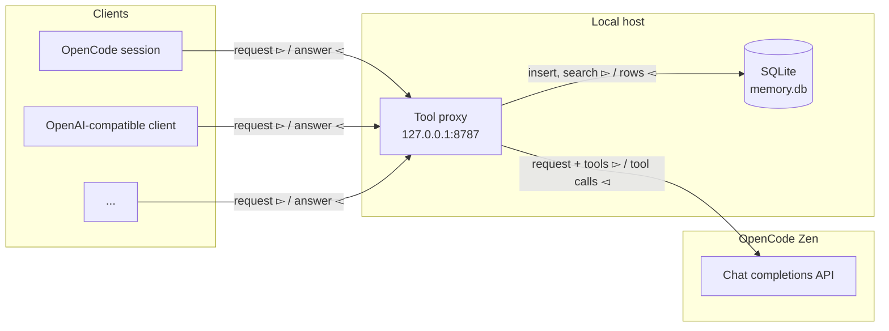

# Put Tools Behind the Model: An OpenAI-Compatible Proxy

A tool-calling model does not run your code. It returns a `tool_calls` list, and the client runs each function. That is the contract of the OpenAI chat API.

The contract is also a seam. Put a server between the client and the model, and the server can run the tools. The client sends messages. The model returns tool calls. The proxy executes them and sends the results back to the model. The client receives one normal answer and never sees the loop.

This post shows the whole proxy in one Python file. Memory is the example toolset: `remember` saves a fact, and `recall` finds it later. The memory is deliberately small. The point is the placement. The same shape works for a ticket search, a database query, or a build trigger.

## The shape



The client connects to the proxy. The proxy is the only process that holds the Zen key. The tools and the data stay on the local host. The proxy keeps no session state. The SQLite file is the only state.

The client can still define its own tools. The proxy adds only names that the client did not take. It runs only its own calls and passes every other call back to the client.

## The proxy

This is the complete file.

```python
import json
import os
import re
import sqlite3
from contextlib import asynccontextmanager, closing
from pathlib import Path
from typing import Any

import httpx
from fastapi import FastAPI, Request
from fastapi.responses import JSONResponse, Response

BASE_URL = os.environ.get("OPENCODE_BASE_URL", "https://opencode.ai/inference/openai/v1")
API_KEY = os.environ.get("OPENCODE_API_KEY", "")
MODEL = os.environ.get("DEFAULT_MODEL", "qwen3.8-flash")
DB = Path(os.environ.get("MEMORY_DB", "memory.db"))
HEADERS = {"Authorization": f"Bearer {API_KEY}"}
POLICY = "Save durable facts with remember. Call recall before you answer a question about the user."


def tool(name: str, description: str, field: str) -> dict[str, Any]:
    return {
        "type": "function",
        "function": {
            "name": name,
            "description": description,
            "parameters": {
                "type": "object",
                "properties": {field: {"type": "string"}},
                "required": [field],
            },
        },
    }


TOOLS = [
    tool("remember", "Save one durable fact about the user.", "fact"),
    tool("recall", "Search saved facts with a short keyword query.", "query"),
]
OWNED = {item["function"]["name"] for item in TOOLS}


def run_tool(name: str, raw: str) -> str:
    args = json.loads(raw)
    with closing(sqlite3.connect(DB)) as db:
        db.execute("CREATE TABLE IF NOT EXISTS facts (id INTEGER PRIMARY KEY, text TEXT)")
        if name == "remember":
            cursor = db.execute("INSERT INTO facts(text) VALUES (?)", (args["fact"],))
            db.commit()
            return json.dumps({"id": cursor.lastrowid})
        words = [w for w in re.findall(r"\w+", args["query"].lower()) if len(w) > 1][:8]
        if not words:
            return json.dumps({"facts": []})
        where = " OR ".join("text LIKE ?" for _ in words)
        rows = db.execute(
            f"SELECT id, text FROM facts WHERE {where} LIMIT 5",
            [f"%{word}%" for word in words],
        ).fetchall()
        if len(rows) < 5:
            rows = db.execute("SELECT id, text FROM facts ORDER BY id DESC LIMIT 5").fetchall()
        return json.dumps({"facts": [{"id": row[0], "text": row[1]} for row in rows]})


@asynccontextmanager
async def lifespan(app: FastAPI):
    async with httpx.AsyncClient(base_url=BASE_URL, timeout=180) as client:
        app.state.zen = client
        yield


app = FastAPI(lifespan=lifespan)


def sse(data: dict[str, Any]) -> str:
    choice = data["choices"][0]
    base = {key: data[key] for key in ("id", "created", "model")}
    base["object"] = "chat.completion.chunk"
    delta = {"role": "assistant", "content": choice["message"].get("content")}
    chunks = [
        {**base, "choices": [{"index": 0, "delta": delta, "finish_reason": None}]},
        {**base, "choices": [{"index": 0, "delta": {}, "finish_reason": "stop"}]},
    ]
    return "".join(f"data: {json.dumps(chunk)}\n\n" for chunk in chunks) + "data: [DONE]\n\n"


@app.post("/v1/chat/completions")
async def chat(request: Request):
    body = await request.json()
    stream = body.pop("stream", False)
    body.pop("stream_options", None)
    messages = [{"role": "system", "content": POLICY}, *body.pop("messages", [])]
    client_tools = body.pop("tools", None) or []
    taken = {item["function"]["name"] for item in client_tools}
    tools = [*client_tools, *(item for item in TOOLS if item["function"]["name"] not in taken)]
    body["model"] = body.get("model") or MODEL
    body["tool_choice"] = body.get("tool_choice", "auto")

    for _ in range(6):
        response = await request.app.state.zen.post(
            "/chat/completions",
            json={**body, "messages": messages, "tools": tools},
            headers=HEADERS,
        )
        if response.status_code != 200:
            return JSONResponse(response.json(), status_code=response.status_code)
        data = response.json()
        message = data["choices"][0]["message"]
        calls = message.get("tool_calls") or []
        if not calls or any(call["function"]["name"] not in OWNED for call in calls):
            break
        messages.append({"role": "assistant", "content": message.get("content"), "tool_calls": calls})
        for call in calls:
            messages.append(
                {
                    "role": "tool",
                    "tool_call_id": call["id"],
                    "content": run_tool(call["function"]["name"], call["function"]["arguments"]),
                }
            )
    else:
        return JSONResponse({"error": {"message": "tool loop limit"}}, status_code=502)

    if not stream:
        return JSONResponse(data)
    return Response(sse(data), media_type="text/event-stream")


@app.get("/v1/models")
async def models(request: Request):
    response = await request.app.state.zen.get("/models", headers=HEADERS)
    return JSONResponse(response.json(), status_code=response.status_code)


@app.get("/health")
async def health():
    return {"ok": True, "model": MODEL, "db": str(DB)}


if __name__ == "__main__":
    import uvicorn

    uvicorn.run(app, host="127.0.0.1", port=int(os.environ.get("PORT", "8787")))
```

## The loop

The request handler does five things:

1. It removes `stream` and `stream_options`. The proxy asks Zen for a full answer, even when the client wants a stream.
2. It adds a policy message before the client messages.
3. It merges the client tools with `remember` and `recall`.
4. It calls Zen and checks the answer for tool calls.
5. It runs each owned call and sends the results back.

The tool result is a normal `tool` message with the same `tool_call_id`. That is the OpenAI tool protocol. The model reads the result and continues. The client sees only the final answer.

The loop stops on three conditions:

- The answer has no tool calls. The proxy returns it.
- The answer has a call that the proxy does not own. The proxy returns the whole response, and the client runs its own tool.
- The loop reaches six rounds. The proxy returns `502`.

The six-round limit is a guard. A model that keeps calling tools is a bug, not a feature.

Streaming is buffered. The proxy waits for the loop to end, then emits two SSE chunks and `[DONE]`. A token-by-token stream would need to hold the upstream stream open and pause it for tool calls. That is more state to test. This version chooses a simple loop over latency.

## Run it

```bash
uv init tool-proxy
cd tool-proxy
uv add fastapi httpx "uvicorn[standard]"
```

Save the code as `app.py`, then create `.env`:

```text
OPENCODE_API_KEY=your-key-here
DEFAULT_MODEL=qwen3.8-flash
PORT=8787
MEMORY_DB=memory.db
```

The proxy reads the Zen key from its own environment. The client never supplies the real key. Add `.env` and `memory.db` to `.gitignore`, then start the proxy:

```bash
uv run --env-file .env python app.py
```

The proxy listens on `127.0.0.1:8787`. It has no authentication, so keep it on the loopback address.

## Connect a client

The proxy speaks the OpenAI chat format. The base URL is `http://127.0.0.1:8787/v1`, and the API key is any non-empty string.

```python
from openai import OpenAI

client = OpenAI(base_url="http://127.0.0.1:8787/v1", api_key="local")
response = client.chat.completions.create(
    model="qwen3.8-flash",
    messages=[{"role": "user", "content": "What do you remember about me?"}],
)
print(response.choices[0].message.content)
```

OpenCode uses the same base URL in a custom provider. Set `capabilities.tools` to `true` in the model entry. Without it, OpenCode may not offer tools to the model, and the proxy never runs.

## A live test

First, save a fact:

```bash
curl -s http://127.0.0.1:8787/v1/chat/completions \
  -H 'Content-Type: application/json' \
  -d '{"model":"qwen3.8-flash","messages":[{"role":"user","content":"Remember that my name is Martin and I prefer tea over coffee."}]}'
```

The model calls `remember` twice. The proxy runs both calls and stores two rows:

```text
(1, "The user's name is Martin.")
(2, 'Martin prefers tea over coffee.')
```

Now start a new conversation:

```bash
curl -s http://127.0.0.1:8787/v1/chat/completions \
  -H 'Content-Type: application/json' \
  -d '{"model":"qwen3.8-flash","messages":[{"role":"user","content":"What is my name and what do I prefer to drink?"}]}'
```

The answer is:

```text
Your name is Martin, and you prefer tea over coffee.
```

The second request has only the question. The proxy calls `recall`, sends the rows back to the model, and the model answers. The client sent no history and no tool definitions.

## Why this shape works

- **The client does not change.** OpenCode, the OpenAI SDK, and any compatible client send a normal request.
- **The key stays on the server.** The proxy holds `OPENCODE_API_KEY`. The client uses a placeholder.
- **The tools stay on the server.** A tool can reach a private database, a local file, or an internal API that the client cannot reach.
- **The tools are ordinary functions.** No new protocol and no model-specific format.
- **The proxy holds no session state.** Each request runs the loop again. There is no cache to invalidate.
- **The loop is bounded.** The proxy cannot spin forever, and a client tool call passes through unchanged.

## Limits

- Memory is global. Every client shares one database. A shared service needs a user column and authentication.
- Retrieval is keyword search. It does not use embeddings.
- The model decides when to write. A model that ignores the tool saves nothing.
- Streaming is buffered. The client gets valid SSE data, but the whole answer arrives at once.
- The `usage` field describes the final upstream call, not the whole loop.

These limits are acceptable for a local tool proxy. The transport pattern is the part worth keeping.

## References

Official sources:

- [OpenAI — Chat Completions API](https://platform.openai.com/docs/api-reference/chat): `messages`, `tools`, `tool_calls`, and the `tool` role.
- [OpenCode — Zen](https://opencode.ai/docs/zen/): Zen models and endpoints.
- [OpenCode — Providers](https://opencode.ai/v2/docs/providers): the OpenAI-compatible provider and `baseURL`.
- [FastAPI](https://fastapi.tiangolo.com/): request handling and responses.
- [httpx](https://www.python-httpx.org/): the async upstream client.
- [SQLite — LIKE](https://www.sqlite.org/lang_expr.html#like): the pattern match used by `recall`.
- [uv](https://docs.astral.sh/uv/): environments and `--env-file`.

Ecosystem sources:

- [OpenAI Python SDK](https://github.com/openai/openai-python): the client example.
- [Mermaid](https://mermaid.js.org/): the diagram syntax.
