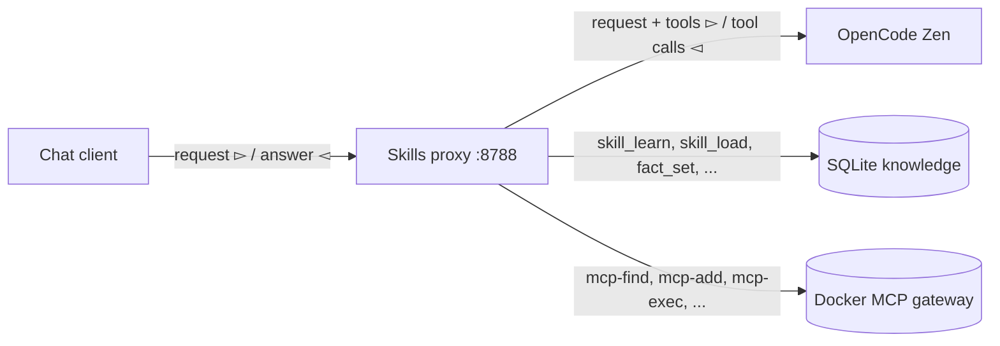

# Teach the Model: Skills and Facts Behind a Proxy

The memory proxy saved facts. This one teaches the model three new things: skills, facts, and MCP tools. A skill is a reusable procedure. A fact is a durable detail about the user or the work. An MCP tool is a capability from a Docker MCP gateway profile. The model learns skills, carries facts, and discovers and runs MCP tools on its own. All three survive into the next session.

The shape is the same as the memory proxy. A local server sits between the client and OpenCode Zen. The server runs the tools. The client sends messages and reads answers.

## The shape



The client connects to the proxy. The proxy is the only process that holds the Zen key. The skills, the facts, the MCP tools, and the data stay on the local host.

## Skills

A skill has three parts: a name, a description, and a body. The name and the description are the front matter. The body is the full content.

The model learns a skill with `skill_learn`. It gives a name, a description, and a body. It can also pass a full `SKILL.md` document with YAML front matter; the proxy parses the front matter and uses it.

The model lists skills with `skill_list`. The list shows only the front matter: name and description. That is enough to decide which skill to use.

The model loads a skill with `skill_load`. Only then does the full body enter the context. This is lazy loading. A proxy with fifty skills does not fill the context with fifty bodies. The model pulls the one it needs.

The proxy also exposes each learned skill as its own tool, using the skill name and description. Calling that tool returns the body. The model can use either path.

## Facts

A fact is a key/value pair. The model stores one with `fact_set`. Facts are different from skills. A skill is a procedure the model may use. A fact is a detail the model should always know.

The proxy injects every fact into the system message as policy. The model does not have to call a tool to recall a fact. The fact is already in the message. The model has it in the next session without asking.

## MCP tools

The proxy has three toolsets: skills, facts, and MCP tools. MCP tools come from a Docker MCP gateway profile. The proxy connects to the profile itself and runs the tools on the server. The harness never sees them.

The model discovers servers with `mcp-find` and enables them with `mcp-add`. The proxy executes each call through `docker mcp tools call` and sends the result back to the model. The loop does not change. The transport does not care what the tool does.

For now we use the MCP gateway for simplicity. The proxy shells out to `docker mcp` instead of speaking the protocol itself. That keeps the example short and reuses a working gateway. A later version can speak MCP directly and manage credentials itself.

## The store

Skills and facts live in one SQLite file. Two tables.

```python
class Skills:
    def __init__(self, path: Path) -> None:
        self.path = path
        with closing(sqlite3.connect(path)) as conn:
            conn.execute(
                "CREATE TABLE IF NOT EXISTS skills ("
                "name TEXT PRIMARY KEY, description TEXT NOT NULL, "
                "content TEXT NOT NULL, created_at TEXT, updated_at TEXT)"
            )
            conn.commit()

    def add(self, name: str, description: str, content: str) -> dict[str, Any]:
        now = self._now()
        with closing(sqlite3.connect(self.path)) as conn:
            conn.execute(
                "INSERT INTO skills(name, description, content, created_at, updated_at) "
                "VALUES (?, ?, ?, ?, ?) "
                "ON CONFLICT(name) DO UPDATE SET "
                "description=excluded.description, content=excluded.content, "
                "updated_at=excluded.updated_at",
                (name, description, content, now, now),
            )
            conn.commit()
        return {"name": name, "description": description}
```

`Facts` is the same shape with a `key` and a `value`. Both classes parse their arguments from the tool call, validate them, and return JSON.

## The tools

The proxy defines eight base tools.

```python
BASE_TOOLS = [
    {"type": "function", "function": {"name": "skill_learn", ...}},
    {"type": "function", "function": {"name": "skill_list", ...}},
    {"type": "function", "function": {"name": "skill_load", ...}},
    {"type": "function", "function": {"name": "skill_forget", ...}},
    {"type": "function", "function": {"name": "fact_set", ...}},
    {"type": "function", "function": {"name": "fact_list", ...}},
    {"type": "function", "function": {"name": "fact_get", ...}},
    {"type": "function", "function": {"name": "fact_forget", ...}},
]
```

The proxy merges these with the client tools. It skips any name the client already took. It also adds one tool per learned skill, using the skill name and description as the function name and description. MCP tools from the gateway profile are added the same way.

## The loop

The request handler follows the same loop as the memory proxy.

1. Read the request. Remove `stream` and `stream_options`.
2. Build the tool list from the client tools, the base tools, the skill tools, and the MCP tools.
3. Add a system message with the policy, the facts, and the skill front matter.
4. Call Zen. If the answer has tool calls, run the owned ones and send the results back. Repeat up to six times.
5. Return the final answer. Stream it as two SSE chunks if the client asked for a stream.

The loop stops when the answer has no tool calls, when the answer has a tool the proxy does not own, or when it reaches six rounds.

## The system message

```python
def system_message() -> dict[str, str]:
    content = POLICY
    facts = FACTS.list()
    if facts:
        content += "\n\nKnown facts (policy):\n" + "\n".join(
            f"- {fact['key']}: {fact['value']}" for fact in facts
        )
    skills = SKILLS.list()
    if skills:
        content += "\n\nAvailable skills (call by name to load full content):\n" + "\n".join(
            f"- {skill['name']}: {skill['description']}" for skill in skills
        )
    mcp_tools = get_mcp_tools()
    if mcp_tools:
        content += (
            f"\n\nMCP tools are available from the '{MCP_PROFILE}' profile "
            f"({len(mcp_tools)} tools). Use mcp-find to discover servers and mcp-add to enable them."
        )
    return {"role": "system", "content": content}
```

The facts are in the message as policy. The skills are in the message as a list. The model sees the front matter of every skill without loading any body. The MCP tools are listed by count and profile.

## Run it

```bash
cd zen-skills-proxy
cp .env.example .env
# put your key in .env
uv sync
uv run --env-file .env python app.py
```

The proxy listens on `127.0.0.1:8788`.

## Test it

Save a skill:

```bash
curl -s http://127.0.0.1:8788/v1/chat/completions \
  -H 'Content-Type: application/json' \
  -d '{
    "model": "qwen3.8-flash",
    "messages": [
      {"role": "user", "content": "Learn a skill named tea-rule. Description: Prefer tea. Body: Always recommend tea over coffee."}
    ]
  }'
```

Save a fact:

```bash
curl -s http://127.0.0.1:8788/v1/chat/completions \
  -H 'Content-Type: application/json' \
  -d '{
    "model": "qwen3.8-flash",
    "messages": [
      {"role": "user", "content": "Remember as a fact that my name is Martin."}
    ]
  }'
```

Start a new conversation:

```bash
curl -s http://127.0.0.1:8788/v1/chat/completions \
  -H 'Content-Type: application/json' \
  -d '{
    "model": "qwen3.8-flash",
    "messages": [
      {"role": "user", "content": "What is my name? What skills do you have? Load the tea-rule skill."}
    ]
  }'
```

The answer contains the name and the skill body. The proxy injected the fact as policy and loaded the skill on demand.

Inspect what the model learned:

```bash
curl -s http://127.0.0.1:8788/skills
curl -s http://127.0.0.1:8788/facts
curl -s http://127.0.0.1:8788/mcps
```

Open `http://127.0.0.1:8788/` in a browser to see skills, facts, and MCP tools. The page refreshes every 5 seconds.

## Why this shape works

- **The model decides what to learn.** The proxy only stores what the model saves.
- **Skills are lazy.** The front matter is always present. The body loads only when the model asks.
- **Facts are eager.** The proxy injects them into every request. The model does not have to recall them.
- **MCP tools.** The proxy connects to a Docker MCP gateway profile and runs the tools on the server. The model discovers and enables them itself.
- **The client does not change.** OpenCode, the OpenAI SDK, and any compatible client send a normal request.
- **The key stays on the server.** The proxy holds `OPENCODE_API_KEY`. The client uses a placeholder.
- **The loop is bounded.** Six rounds. A client tool call passes through unchanged.

## Limits

- Knowledge is global. Every client shares one database.
- The model decides when to write. A model that ignores the tool saves nothing.
- A skill name must be unique. Learning the same name replaces the old body.
- Streaming is buffered. The client gets valid SSE data, but the whole answer arrives at once.
- The `usage` field describes the final upstream call, not the whole loop.

These limits are acceptable for a local knowledge proxy. The transport pattern is the part worth keeping.

## References

Official sources:

- [OpenAI — Chat Completions API](https://platform.openai.com/docs/api-reference/chat): `messages`, `tools`, `tool_calls`, and the `tool` role.
- [OpenCode — Zen](https://opencode.ai/docs/zen/): Zen models and endpoints.
- [OpenCode — Providers](https://opencode.ai/v2/docs/providers): the OpenAI-compatible provider and `baseURL`.
- [FastAPI](https://fastapi.tiangolo.com/): request handling and responses.
- [SQLite](https://www.sqlite.org/): the store.
- [uv](https://docs.astral.sh/uv/): environments and `--env-file`.

Ecosystem sources:

- [OpenAI Python SDK](https://github.com/openai/openai-python): the client example.
- [Mermaid](https://mermaid.js.org/): the diagram syntax.
- [Agent Skills standard](https://agentskills.io/home): the front matter convention used by skills.
- [Docker MCP Toolkit](https://docs.docker.com/ai/mcp-catalog-and-toolkit/): the gateway profile used for MCP tools.
